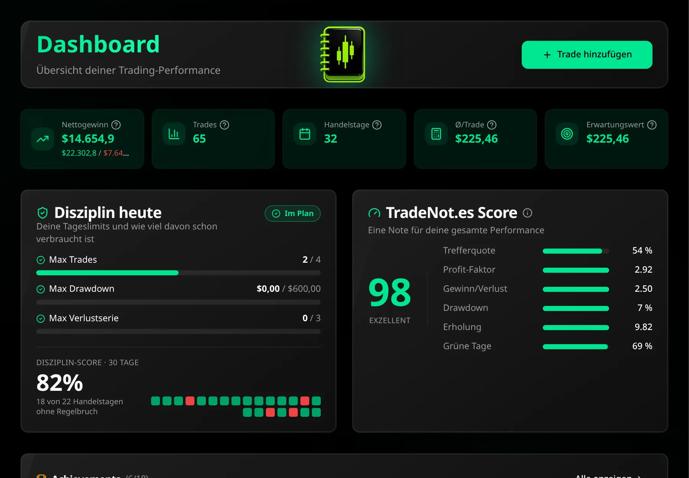

<p align="center">
  <a href="https://tradenot.es"></a>
</p>

<h1 align="center">TradeNot.es</h1>

<p align="center">
  <strong>Kostenloses Trading-Journal für Futures-, Aktien- und Prop-Firm-Trader.</strong><br />
  Ohne Abo, ohne Werbung, ohne Tracking. Als Dienst auf <a href="https://tradenot.es">tradenot.es</a> und selbst hostbar.
</p>

<p align="center">
  <a href="https://tradenot.es">Website</a> ·
  <a href="https://tradenot.es/features">Funktionen</a> ·
  <a href="https://tradenot.es/hilfe">Hilfe</a> ·
  <a href="#selbst-hosten">Selbst hosten</a> ·
  <a href="#lizenz">Lizenz</a>
</p>

<p align="center">
  
  
  
</p>

<p align="center">
  
</p>

> *English: TradeNot.es is a free, open-source trading journal (AGPL-3.0) with automatic import from
> NinjaTrader and Interactive Brokers, discipline limits, behaviour and rule-adherence analytics. Use it at
> [tradenot.es](https://tradenot.es) or host it yourself with Docker. The app is available in six languages.*

## Was TradeNot.es kann

- **Trades kommen von selbst:** NinjaTrader-Add-on (alle Konten, Teilausführungen, Gebühren, MFE/MAE),
  Interactive Brokers per Flex-Abfrage (täglicher Abruf), TradingView-Export und eigene CSV-Vorlage
- **Disziplin:** Tageslimits für Trades, Verlust und Verlustserien, Pflichtpause nach Verlustserie,
  automatische Erkennung von Revenge-Trades und Overtrading
- **Auswertungen:** Fehler und Gefühlslage pro Trade, Regeltreue (Prozess gegen Ergebnis), „Was bei dir funktioniert“,
  Equity-Kurve, R-Multiple, Risiko-Simulator, Reports nach Setup, Symbol, Zeit, Konto (Sim/Evaluation/Funded/Live)
- **Wirtschaftskalender:** Fed, EZB, BoE, BoJ, CPI, NFP, dazu Fed-Reden und angekündigte Auftritte des US-Präsidenten,
  jede Uhrzeit in der Zeitzone des Nutzers
- **Journal, Tagesvorbereitung, Mentor-Modus** (einzelne Trades per Link teilen)
- **Deine Daten gehören dir:** Export als ZIP (inkl. wieder importierbarer CSV und Screenshots), Löschen jederzeit,
  Server in der EU, keine Analyse- oder Werbedienste
- **6 Sprachen:** Deutsch, Englisch, Spanisch, Französisch, Italienisch, Niederländisch

## Selbst hosten

TradeNot.es läuft als ein Container (API und Frontend) plus PostgreSQL, siehe [`compose.yaml`](compose.yaml) und
den Abschnitt [Betrieb](#betrieb) weiter unten. Mindestens nötig sind `BASE_URL`, `BETTER_AUTH_SECRET` und
`POSTGRES_PASSWORD`; für Bestätigungs- und Passwort-Mails ein SMTP-Zugang. Updates: neues Image, Neustart,
die Datenbank-Migrationen laufen automatisch.

Hinweis: Die Rechtstexte (Impressum, Datenschutz) und die Startseite sind die der offiziellen Instanz
tradenot.es; Betreiberangaben stehen in [`src/config/operator.ts`](src/config/operator.ts). Eine vereinfachte
Selbsthost-Variante (nur App, ohne Startseite und Rechtstexte, auch ohne Mailserver, fertige Images) ist geplant.

## Aufbau

- `src/`: Frontend (React, Vite, Tailwind/shadcn, i18n in 6 Sprachen)
- `server/`: Backend (Node, Hono, PostgreSQL, Better Auth)
  - `src/auth.ts`: Login mit E-Mail/Passwort, E-Mail-Bestätigung, Passwort-Reset, TOTP-2FA
  - `src/data.ts`: generischer Datenzugang für das Frontend (`db.from(...)` in `src/lib/api.ts`).
    Jede Tabelle steht mit erlaubten Aktionen in einer Freigabeliste, die Nutzer-ID setzt immer der Server.
  - `src/routes/import.ts`: Trade-Import (`POST /api/import-trades`): Add-on mit Header `X-API-Key`, CSV und Vorlage für eingeloggte Nutzer
  - `src/matching.ts`: Ausführungen → Trades (FIFO, flat bis flat), `src/ibkr.ts`: Interactive-Brokers-Abruf
  - Kalenderzeiten: jeder Termin steht in der Zeitzone seiner Institution (`eventTimeZone` in `src/lib/economicCalendar.ts`) und wird mit `src/lib/timezone.ts` in die Zeitzone des Nutzers umgerechnet (Einstellung oder Gerät); Prüfungen rund um die Zeitumstellung: `npx tsx src/lib/timezone.check.ts`
  - `src/feedback.ts`: „Verbesserungsvorschlag?“ in der Seitenleiste (Fehler/Idee/Sonstiges) → Mail an `CONTACT_TO` (Antwort an den Nutzer) und, wenn `GITHUB_FEEDBACK_TOKEN`/`GITHUB_FEEDBACK_REPO` gesetzt sind, ein öffentliches GitHub-Issue nur mit Titel und Text (Name, E-Mail und technische Angaben nur in der Mail); höchstens 5 pro Nutzer und Stunde. Tests: `test/feedback.ts`
  - `src/marketEvents.ts`: holt stündlich Fed-Reden/FOMC-Protokolle (federalreserve.gov) und angekündigte Auftritte des US-Präsidenten (Roll Call Factba.se) für den Kalender; Tests in `test/marketEvents.ts`
  - `migrations/`: SQL-Migrationen, laufen beim Start automatisch
- Passwörter mindestens 12 Zeichen (`src/lib/password.ts` und `minPasswordLength` im Server); nach 10 falschen Passwörtern innerhalb einer Stunde ist ein Konto 15 Minuten für Passwort-Anmeldungen gesperrt, mit Warn-Mail (`server/src/loginGuard.ts`, Tests: `test/loginGuard.ts`)
- Schutz vor Bots: Limits pro IP in Produktion (Registrierung, Passwort-Reset, Bestätigungsmail je 5/Stunde, Anmeldung 3/10 s über Better Auth; Kontaktformular 5/Stunde in `server/src/limits.ts`), verstecktes Honeypot-Feld in Registrierung und Kontaktformular, Tests: `test/limits.ts`
- Captcha: eigenes Proof-of-Work im ALTCHA-Format (`server/src/altcha.ts`, `src/components/AltchaWidget.tsx`), ohne Fremddienst und ohne Cookies; rechnet beim Anzeigen des Formulars von selbst los, SHA-256 in reinem JS (`src/lib/sha256.ts`, Prüfung: `npx tsx src/lib/sha256.check.ts`), daher auch ohne HTTPS (z. B. Dev-Server im LAN)
- `src/config/operator.ts`: Betreiber und E-Mail-Adresse für Impressum, Datenschutz, Kontakt; die Texte selbst stehen unter `legal.*` in den Sprachdateien
- `src/export.ts` (Server): Datenexport als ZIP (`GET /api/export`)

## Entwicklung

```sh
npm install && npm --prefix server install
npm run dev:server   # Backend auf :3000 mit eigener Postgres (embedded-postgres, Daten in server/data/)
npm run dev          # Frontend auf :8080, leitet /api an das Backend weiter
```

Ohne SMTP-Konfiguration verschickt das Backend keine Mails, sondern schreibt die Links
(Bestätigung, Passwort-Reset) ins Log.

Smoke-Test gegen das laufende Backend (Log-Datei für die Bestätigungslinks):

```sh
npm --prefix server run dev > /tmp/tradenotes-dev.log 2>&1 &
cd server && npx tsx test/smoke.ts http://localhost:3000 /tmp/tradenotes-dev.log
```

## Betrieb

`compose.yaml` startet App und Datenbank als eigenen Stack. Die App lauscht nur auf `127.0.0.1:3010`,
davor sitzt der Caddy des Servers. Alles für den Server liegt in `deploy/`:

- `deploy/Caddyfile.tradenotes`: Site-Block (HTTPS, www → ohne www, Sicherheits-Header, **kein Zugriffslog**,
  so steht es in der Datenschutzerklärung)
- `deploy/deploy.sh`: `git pull`, Image bauen, neu starten, auf den Health-Check warten
- `deploy/backup.sh`: täglich Datenbank-Dump und Screenshots nach `/opt/tradenotes-backups`, 14 Tage aufbewahrt
  (die Datenschutzerklärung nennt diese 14 Tage)

Erstes Einrichten:

```sh
git clone -b eigenes-backend git@github.com:tradenot-es/tradenotes.git /opt/tradenotes
cd /opt/tradenotes
cp .env.example .env   # Werte eintragen, Geheimnisse mit openssl rand -hex 32 / -hex 24
docker compose up -d --build
# Caddy: Inhalt von deploy/Caddyfile.tradenotes in den Caddyfile übernehmen, Caddy neu laden
# Backup: Cron-Zeile aus deploy/backup.sh eintragen
```

Danach genügt für Updates `deploy/deploy.sh`. Migrationen laufen beim Start der App.

Wiederherstellen aus dem Backup:

```sh
docker compose exec -T db pg_restore -U tradenotes -d tradenotes --clean --if-exists < /opt/tradenotes-backups/db_<stempel>.dump
docker run --rm -v tradenotes_uploads:/data -v /opt/tradenotes-backups:/backup alpine \
  sh -c 'rm -rf /data/* && tar xzf /backup/uploads_<stempel>.tar.gz -C /data'
```

## Lizenz

tradenot.es steht unter der **GNU Affero General Public License v3.0 oder später** (`AGPL-3.0-or-later`),
siehe [LICENSE](LICENSE). Jeder darf den Code nutzen, ändern und selbst betreiben. Wer eine veränderte
Version als Dienst im Netz anbietet, muss deren Quellcode den Nutzern ebenfalls unter der AGPL zugänglich
machen. Eingebundene Fremdbausteine (z. B. shadcn/ui, Radix, Recharts) behalten ihre eigenen Lizenzen (MIT u. a.).

## Geschichte

Ursprünglich 2025 mit Lovable gebaut, seit Oktober 2026 mit eigenem Backend ohne Lovable und Supabase. Die damalige
Produktbeschreibung steht in [docs/MVP-SPEC.md](docs/MVP-SPEC.md).
